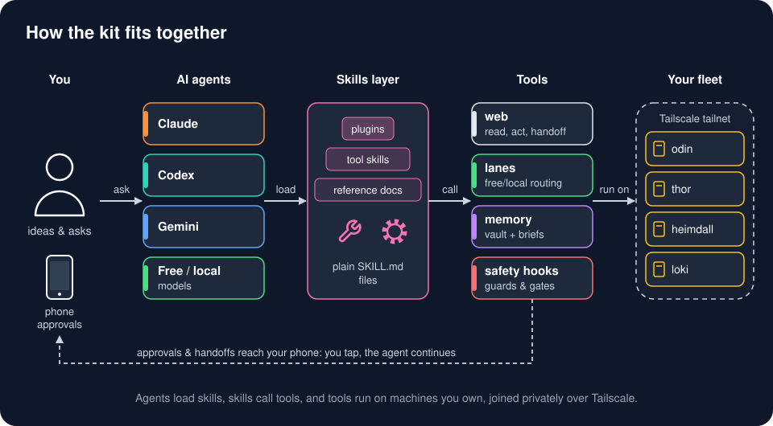

# AI Workflow Kit

A working AI coding workflow (Claude Code + Codex, memory, safety hooks, model routes) and five machine setups you can install from one repo.

## What it is

Most AI setups are a pile of prompts that drift. This kit is the real, daily-used setup behind one person's home lab, privacy-scrubbed: the hooks, CLIs, routes and server recipes, plus an installer that puts only the parts you pick on your machines.



```bash
git clone https://github.com/Phoenixn82/ai-workflow-kit.git && cd ai-workflow-kit
install/doctor.sh --profile odin                        # what this machine already has
install/install.sh --profile odin,telegram --dry-run    # print the plan, change nothing
install/install.sh --profile odin,telegram              # install what is missing, after you say yes
```

## Features

- **Five setups named after real machines.** Pick a laptop cockpit, a media server, an always-on server, a GPU box or a thin client, plus a Telegram add-on. Each one is a profile you can install alone or combine.
- **One installer for every tool.** `install/tools.json` lists each tool with its homepage, license and an install method per OS (pacman, apt, brew, mise, uv, npm, Docker) or a manual line. Third-party tools are downloaded from their official source at install time, never copied into this repo.
- **Never clobbers your setup.** Nothing installs until you confirm. Every file it replaces gets a timestamped backup beside it, and your agent config is only merged (with a backup) when you pass `--harness`.
- **Routes, not habits.** One `lanes.json` says which model and effort each kind of job gets; `route` and `cx` read it, so changing a model is a one-line edit.
- **One session, many models.** Optional [Hermes harness](docs/hermes.md): trusted free-model pools, automatic fallback, manual model hops, scrubbed outside helpers, and a second Hermes for a quarantined box that can't open a connection to your other machines.
- **Memory that writes itself.** Every session is distilled into a plain-markdown vault, and the most relevant notes are searched and injected on every prompt.
- **Safety that is always on.** A fail-closed hook dispatcher, a secret firewall scored on a 182-case corpus, a public-push gate, and one `HALT` file that stops every automation.

## Tech stack

- **Languages:** bash, Python 3 (stdlib first), a little JavaScript
- **AI:** Claude Code, Codex CLI, Ollama for local models, an optional free-model router
- **Infra:** systemd user units, Docker Compose, Tailscale, restic, Uptime Kuma, Jellyfin
- **Install backends:** pacman, apt, Homebrew, mise, uv, npm, Docker

## Getting started

### Prerequisites

- git, bash and Python 3 on each machine.
- One AI agent you already use (Claude Code or Codex can run the installer for you; a chat-only AI can still follow the docs).
- Optional: Tailscale, if you set up more than one machine.

Works on:

| Piece | Linux (Arch, Debian/Ubuntu) | macOS | Windows |
|---|---|---|---|
| Ideas, skills, prompts (`docs/`, `framework/_system/skills/`) | yes | yes | yes |
| Installer and doctor (`install/`) | yes | yes (Homebrew) | via WSL |
| Hooks (`framework/harness/`) | yes | yes (bash + Python 3) | via WSL or Git Bash |
| CLIs (`framework/_tools/`) | yes | most; systemd timers are skipped | via WSL |
| Profiles: odin, heimdall, loki | yes, best | partly: Linux-only features are skipped with a message | server recipes in `servers/windows/` |
| Profile: thor | NVIDIA GPU, 8 GB VRAM or more | Apple silicon, 16 GB or more | no |
| Profile: raven, telegram add-on | yes | yes | raven only |

The framework was built on Arch Linux (Omarchy). Paths like `$HOME/AI_Projects` assume that layout; the implementation prompt has your AI rewrite them for your machines.

### Pick your setup

| Profile | Pick it if you want | What you get |
|---|---|---|
| [**odin**](profiles/odin/) | the cockpit: the laptop or desktop where you run Claude Code and Codex | hooks + dispatcher + secret firewall, push gate, lanes and routes (`route`, `cx`), the `web` CLI, vault + prompt-time search, automatic session memory, weekly review, harness lint, retention, a CPU ceiling for agent fan-outs |
| [**loki**](profiles/loki/) | a media server for your own media | Jellyfin with hardware transcoding, Samba shares, backups pulled by thor, a one-way firewall so it cannot reach your other machines |
| [**heimdall**](profiles/heimdall/) | an always-on server with hard rules, and an out-of-the-box way to put your projects on it | uptime checks that know when a box sleeps on purpose, Wake-on-LAN, a jobs registry with kill switches, alerts, the vault-search embed server, a backup target, and a deploy kit (Compose, Caddy or Tailscale Serve, a systemd unit, a health check, a restore script) |
| [**thor**](profiles/thor/) | a heavy local AI PC | Ollama, Whisper on the GPU, an optional free-model router, sleep when idle with `thor-up` to wake it, a heat guard, a backup target |
| [**raven**](profiles/raven/) | a viewer: a laptop or tablet that only connects | Tailscale, an SSH config for the fleet, a terminal multiplexer, Claude Code Remote Control, phone handoffs; nothing heavy |
| [**telegram**](profiles/telegram/) (add-on) | phone alerts, one chat per topic | `tg <topic> "<msg>"` with only heat alerts audible, the telegram skill, and `tg-admin` to create groups and bots (Linux with a logged-in Telegram Desktop; everyone else makes one bot with @BotFather, once); with no bot set up every alert is a quiet no-op |

You don't need all of them. One laptop as **odin** is a full setup; one old laptop as **heimdall** is the biggest next step. Profiles combine: `--profile odin,telegram`.

### Install

Two ways, same result.

1. **Let your AI do it.** Open your agent in this folder and paste [`implementation-prompt.md`](implementation-prompt.md). It asks which profiles fit your machines, runs the doctor, shows you the dry-run plan, and installs only after you say yes.
2. **Run the installer yourself:**

   ```bash
   install/doctor.sh --profile heimdall                 # ok | missing | wrong-version, one line per tool
   install/install.sh --profile heimdall --dry-run      # the plan: method per tool, or "install manually: <homepage>"
   install/install.sh --profile heimdall                # asks before it installs; --yes skips the question
   install/install.sh --profile odin --harness          # also merge hooks and settings into ~/.claude (backup first)
   ```

   `--os arch|debian|macos` forces a package backend. Exit codes: 0 done, 1 an install failed, 2 bad arguments or a failed hardware check (for example `--profile thor` on a machine without a big enough GPU). See [`install/`](install/) for the manifest and options, and [`install/uninstall.md`](install/uninstall.md) to undo a profile.

### Configure

Tools that talk to your other machines read one file, `~/.config/ai-workflow-kit/hosts.env`. Copy [`examples/hosts.env.example`](examples/hosts.env.example) there and fill in only the hosts you have:

```bash
mkdir -p ~/.config/ai-workflow-kit
[ -e ~/.config/ai-workflow-kit/hosts.env ] || install -m 600 examples/hosts.env.example ~/.config/ai-workflow-kit/hosts.env   # never overwrites yours
```

A tool that needs an unset value stops with a clear "set X in hosts.env" message; nothing points at the maintainer's machines.

### Run

```bash
install/doctor.sh                                    # re-check any time
KIT_HOME=$PWD framework/harness/bin/route list       # which model and effort each kind of job gets
framework/harness/bin/thor-up --self-test            # each bundled tool has an offline self-test
tg --test fleet                                      # telegram add-on: prints "telegram not configured" until you set it up
```

Take two or three pieces, live with them for a week, then come back for more.

## How it works

Agents load skills, skills call tools, and tools run on machines you own, joined privately over Tailscale. Each machine has one job and one name (odin, loki, heimdall, thor, raven). A profile is a `profile.json` that lists tool ids from one manifest, `install/tools.json`, plus the services, scheduled jobs and rules that machine runs. `install.sh` reads the profile, checks the hardware, prints a plan, and installs what is missing; `doctor.sh` reports what a machine has. First-party code under `framework/` is exported from the live setup by `tools/sync-kit.py` (allowlist, scrub, syntax check, secret scan), so the repo tracks what actually runs.

| Folder | What it gives you | Read first |
|---|---|---|
| [`profiles/`](profiles/) | The six setups: what each runs and how to build it | [odin](profiles/odin/) |
| [`install/`](install/) | Tool manifest, installer, doctor | [install](install/) |
| [`docs/`](docs/) | The ideas, in plain English, one page each | [philosophy](docs/philosophy.md), [lessons](docs/lessons.md) |
| [`framework/`](framework/) | The real files: skills, hooks, CLIs, Codex and Claude config (privacy-scrubbed) | [AGENTS.md](framework/AGENTS.md) |
| [`servers/`](servers/README.md) | Turning an old laptop into a headless server on Linux, macOS or Windows | [servers](servers/README.md) |
| [`examples/`](examples/) | A starter vault and config templates | [vault](examples/vault/README.md) |
| [`tools/`](tools/README.md) | How this repo is synced and scrubbed (you can ignore it) | |

The ideas, one line each:

- **Right tool, right size:** skip it, stdlib, a native feature, an installed dependency, search GitHub first, then the least code. → [philosophy](docs/philosophy.md)
- **Two strong agents, routes decide:** Claude and Codex both write code; `lanes.json` says which model fits which job. → [agents and lanes](docs/agents-and-lanes.md)
- **One session, many models:** Hermes keeps context across trusted pools, with or without a local GPU; outside helpers receive generic questions, and a quarantined box gets its own Hermes that reaches only the model router. → [Hermes](docs/hermes.md)
- **One web CLI:** read, crawl, log in, and hand CAPTCHAs to your phone; never solve them. → [web](docs/web.md)
- **Memory that writes itself:** sessions distilled into a vault, searched on every prompt. → [memory](docs/memory.md)
- **Safe by default:** fail-closed hooks, a secret firewall, a push gate, one kill switch. → [safety](docs/safety.md)
- **A fleet on a tailnet:** five names, sleep when idle, wake on demand. → [fleet](docs/fleet.md)
- **What the last audit taught:** machinery beats prose rules; every layer needs a feedback loop and a kill date. → [lessons](docs/lessons.md)

## License

MIT, see [LICENSE](LICENSE).
