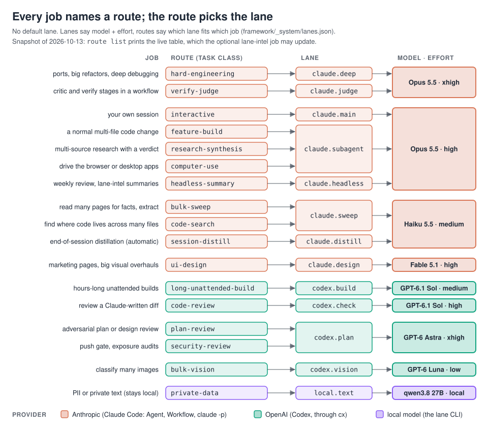
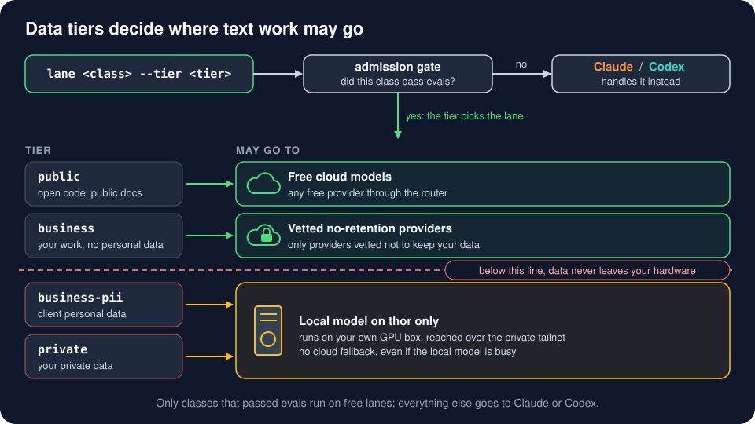

# Agents, lanes and routes

Two words carry this page:

- A **lane** is a model plus an effort level, for example `codex.plan` = GPT-6 Astra at xhigh.
- A **route** is a task class that names the lane fitting that job, for example `plan-review` → `codex.plan`.

Both live in one file, [`framework/_system/lanes.json`](../framework/_system/lanes.json). **There is no default lane.** Every dispatch (a Claude subagent, a Workflow `agent()`, `cx` for Codex, `claude -p`, or the `lane` CLI) names a task class, and the class decides the model; a hook (`route-guard.py`) denies a Claude subagent or Workflow `agent()` call that names no model, so nothing falls back to a default. The goal is the **cheapest lane that still gets great results**, and it is fluid: when your Claude usage runs ahead of the week, some jobs move to Codex on their own ([quota pace](#quota-pace)). A trivial lookup (a grep, one file read) is not dispatched at all; the session does it inline.



## The lanes

Snapshot of 2026-10-13. `route list` prints the live values, and the optional [lane-intel job](#optional-the-daily-lane-intel-job) may change them.

| Lane | Model | Effort | What it is for |
|---|---|---|---|
| `claude.main` | Opus 5.5 | high | your interactive sessions |
| `claude.subagent` | Opus 5.5 | high | routed judgment work (builds, research, computer use); not an env default |
| `claude.deep` | Opus 5.5 | xhigh | hard engineering |
| `claude.judge` | Opus 5.5 | xhigh | critic and verify stages a workflow opts into |
| `claude.headless` | Opus 5.5 | high | scheduled summaries through `claude -p` |
| `claude.sweep` | Haiku 5.5 | medium | extraction fan-outs where most attempts are wasted |
| `claude.distill` | Haiku 5.5 | medium | end-of-session distillation; `local.text` is the fallback |
| `claude.design` | Fable 5.1 | high | marketing pages and big design overhauls, by deliberate pick |
| `codex.build` | GPT-6.1 Sol | medium | implementation (`cx build`) |
| `codex.check` | GPT-6.1 Sol | high | code review (`cx check`), the cross-lab reviewer of Claude's code |
| `codex.plan` | GPT-6 Astra | xhigh | adversarial plan review (`cx plan`) |
| `codex.vision` | GPT-6 Luna | low | bulk image classification in headless pipelines |
| `codex.interactive` | GPT-6.1 Sol | medium | the default in `~/.codex/config.toml` |
| `local.text` | qwen3.8-text 27B on thor | n/a | private data, never sent to a cloud model |

Standing rules, also in the file's `rules` list: the **cheapest lane that still gets great results**, judged per finished task rather than per token (Opus only where a cheaper lane misses the bar, xhigh only for verify stages and hard engineering); **fluid with quota** (below); every Agent and Workflow `agent()` call names its model; **max only** where it is the cheapest lane that passes a bar xhigh missed (none today); Claude writes and a Codex model reviews (cross-lab review); every lane change names its source.

## The 17 routes

| Task class | Lane (model, effort) | Use it for | Why |
|---|---|---|---|
| `interactive` | `claude.main` (Opus high) | your own session | xhigh scores 56.0 against 53.6 for high on slopalytics (2026-10-12) but costs about twice as much per task; `claude.deep` keeps xhigh for the hard cases |
| `feature-build` | `claude.subagent` (Opus high) | a normal multi-file code change, frontend or backend | Theo's build model, and high sits on the cost frontier; alt `codex.build` |
| `hard-engineering` | `claude.deep` (Opus xhigh) | ports, large refactors, deep debugging, architecture, anything a first attempt got wrong | Opus on xhigh finished a port the OpenAI models stalled on |
| `long-unattended-build` | `codex.build` (Sol medium) | hours-long or high-volume builds that run without supervision | Sol 6.1 tied Opus 5.5 on Terminal Bench at about 1/13 the cost |
| `code-review` | `codex.check` (Sol high) | reviewing a Claude-written diff before it merges | a model from another lab catches what the author model misses |
| `plan-review` | `codex.plan` (Astra xhigh) | adversarial review of a plan, design doc or finished batch | Astra writes the most detailed critiques |
| `security-review` | `codex.plan` (Astra xhigh) | public-push gate reviews, exposure audits, history sanitization | the riskiest reviews get the most thorough reviewer; Astra found 25 real defects in one review round of the setup this kit packages |
| `ui-design` | `claude.design` (Fable high) | marketing pages and big visual overhauls only | strong at screenshot-to-UI but off the frontier for general work, so nothing else routes here |
| `research-synthesis` | `claude.subagent` (Opus high) | multi-source research that needs judgment and a written conclusion | judgment work stays on Opus; alt `codex.check` |
| `bulk-sweep` | `claude.sweep` (Haiku medium) | reading many docs or pages for facts, extraction or classification over many items | when most attempts are wasted, more cheap attempts beat fewer smart ones |
| `code-search` | `claude.sweep` (Haiku medium) | finding where something lives or how it flows across many files, when only the conclusion matters | keeps the parent session's context small, and rereading a long context is most of a session's cost |
| `bulk-vision` | `codex.vision` (Luna low) | classifying many images in a headless pipeline | the cheapest capable vision model with reasoning off |
| `verify-judge` | `claude.judge` (Opus xhigh) | critic and verify stages inside a workflow | xhigh beats high on hard judgment; alt `codex.check` |
| `session-distill` | `claude.distill` (Haiku medium) | end-of-session distillation (runs automatically) | a blind judge scored it well above the local model, at a few cents a session |
| `headless-summary` | `claude.headless` (Opus high) | the weekly review and lane-intel summaries (`claude -p`) | judgment over a week of evidence |
| `computer-use` | `claude.subagent` (Opus high) | driving the identity browser or desktop apps | those tools exist only on Claude's side; Codex's sandbox cannot drive the browser |
| `private-data` | `local.text` (local 27B) | anything with PII or private content | it never leaves your own hardware |

Routes can also name a subagent type. `bulk-sweep` and `code-search` carry `"agent": "lean"`, so `route` prints `subagent_type: lean` (and `agentType: 'lean'` for Workflow scripts). The lean agent ([`framework/harness/agents/lean.md`](../framework/harness/agents/lean.md), installed to `~/.claude/agents/` with `--harness`) starts without your CLAUDE.md files and memory index: a measured Haiku spawn started at 20.2k tokens against 34.2k for general-purpose (−41 %). Use it only when the delegation prompt carries everything the job needs.

Deliberately not routed: Sonnet 5.5 (Opus 5.5 on high scores higher for less), Luna for code, the superseded `gpt-6-sol`, and trivial lookups. Each route in `lanes.json` also carries a `source` (a video timestamp, post id or benchmark snapshot), which `route <class>` prints.

## Quota pace

Lanes are the default pick, not a fixed one. Every `route` call reads your Claude usage (`~/.local/state/omarchy/agents/usage/claude.json`, written by the Omarchy agents bar widget). When the 7-day window is used more than 5 points faster than the week goes by, or the 5-hour window is at 80 % or more, a route that names an `alt` lane resolves to it: `feature-build` to `codex.build`, `research-synthesis` and `verify-judge` to `codex.check`. That work stops counting against your Claude limit. `route list` marks shifted rows with `*` and prints the pace line. Nothing shifts when the data is missing, stale, or shows Codex at 90 % of its own limit. `ROUTE_PACE=over` or `ROUTE_PACE=ok` forces the answer. The daily lane-intel job also holds back any Claude effort increase while you are over pace.

Workflow scripts can't run `route`, so the main loop passes `route --workflow-args` (`{routes, codex}`) into the Workflow's args, and the script takes its models from there (see [`open-loops.js`](../framework/.claude/workflows/open-loops.js)).

## Using a route

Put [`framework/harness/bin/route`](../framework/harness/bin/route) and [`framework/harness/bin/cx`](../framework/harness/bin/cx) on your `PATH` (the installer links them into `~/.local/bin`). `route` needs only Python 3. It reads `lanes.json` on every call, looking in this order:

1. `$ROUTE_LANES`, a path to any `lanes.json`;
2. `$KIT_HOME/framework/_system/lanes.json`, when `KIT_HOME` points at your kit clone;
3. `~/AI_Projects/_system/lanes.json`, the layout the framework was built in;
4. when that one is missing, the `lanes.json` in the tree `route` itself lives in, so `framework/harness/bin/route` run straight from a fresh clone (or through a link into it) reads `<clone>/framework/_system/lanes.json` with nothing set.

`route --lanes-path` prints the file in use. With none of them present, `route` exits 2 and says which variable to set.

```bash
export KIT_HOME=~/src/ai-workflow-kit      # optional: wherever you cloned the kit
route list                                 # the table: class, lane, model, effort, use
route feature-build                        # how to dispatch one class
route --json code-review                   # the same as JSON, for scripts
route --cx plan-review                     # "gpt-6-astra xhigh": what cx uses
route --workflow-args                      # live picks to pass into a Workflow script's args
route --self-test                          # offline checks, plus every route against your table
```

`route <class>` prints the dispatch line for each harness:

```text
feature-build: lane claude.subagent = claude-opus-5-5 high
  use:    a normal multi-file code change in a repo, frontend or backend
  why:    Opus 5.5 is Theo's build model; high sits on the cost frontier
  source: x.com/theo/status/2109593403482948090; slopalytics 2026-10-08 (53.6 at $1.82)
  Agent tool:       model: "opus"  (effort follows the parent; use a Workflow agent() when effort matters)
  Workflow agent(): {model: 'opus', effort: 'high'}
  claude -p:        claude -p --model claude-opus-5-5 --effort high
```

How each caller uses it:

- **Claude's Agent tool** takes the model alias (`opus`, `haiku`, `fable`). Effort follows the parent session, so when effort matters, use a Workflow agent.
- **A Workflow script** passes both to `agent()`: `agent(prompt, {model: 'opus', effort: 'high'})`. A Workflow script cannot read files, so keep one small table at its top that maps each task class it uses to the pair `route` prints, pass every `agent()` its class's pair, and re-copy the table when a lane changes.
- **Codex goes through `cx`**, never a bare `codex exec`: `cx <class|plan|check|build> <read-only|workspace-write|full> <outfile> <prompt>`. A class must route to a `codex.*` lane, or `cx` exits 2 and tells you to dispatch it through Claude or `lane`. `cx` always passes the model, the effort, the sandbox, an output file and a timeout explicitly. `CX_DRY_RUN=1` prints the command instead of running it, and `cx --self-test offline` checks the routing without calling Codex.

  ```bash
  cx plan-review read-only review.md "Review PLAN.md adversarially; list blocking issues first."
  ```

- **Scheduled jobs** use `claude -p --model <model> --effort <effort>`, as printed.
- **Private text** goes through the `lane` CLI on the local model (see below): `lane <admitted-class> --tier private < input`.

### Big work, stage by stage

The routes chain into the loop this kit uses for anything large:

| Stage | Route | Lane today |
|---|---|---|
| Plan and revise | `interactive` | `claude.main`, Opus high |
| Adversarial plan review | `plan-review` | `codex.plan`, Astra xhigh |
| Build | `feature-build`, or `long-unattended-build` for long unsupervised runs | Opus high, or Sol high through `cx build` |
| Review the diff | `code-review` | `codex.check`, Sol high |
| Verify before you call it done | `verify-judge` | `claude.judge`, Opus xhigh |

**No forced split between Claude and Codex.** Both write code. Use Codex when volume or unattended iteration dominates; use Claude when shared context and judgment dominate. One rule of thumb: after two failed attempts at the same sub-task in one lane, hand it to the other.

## Changing a route or a lane

Routes and lanes are plain JSON, so you change them by editing `lanes.json`:

1. **Move a job to another lane:** set `routes.<class>.lane` to any lane the file defines. **Add a job:** add a `routes` entry with `lane`, `use`, `why` and `source`. **Change a model:** edit the lane's `model` or `effort`, never `max`. Keep the model on the `allowed_models` list (add a new model there first): lane-intel only ever applies models on that list.
2. Add a line to `history` with the date, what changed and its source, for example `{"date": "2026-11-02", "by": "me", "change": "claude.subagent: effort high -> xhigh", "source": "my own eval"}`. The lane-intel job (below) never overrides a lane whose newest history entry is newer than its evidence, so this line also protects your hand change.
3. Run `route --self-test`. It resolves every route against your table and fails on a route that points at a missing lane.
4. If you changed `claude.main`, `claude.subagent` or `codex.interactive`, push the change into the harness files that cache it: [`apply_lanes.py`](../framework/_tools/lane-intel/apply_lanes.py) writes `~/.claude/settings.json` (model and effort; it removes any `CLAUDE_CODE_SUBAGENT_MODEL`) and `~/.codex/config.toml`, printing each change; `apply_lanes.py --check` only reports drift. Both files must already exist (it stops with a traceback otherwise); on a machine without Codex, set `model` and `effortLevel` in `settings.json` by hand. `cx` and `route` read `lanes.json` on every call; Workflow scripts take theirs from `route --workflow-args` in their args.

## Optional: the daily lane-intel job

[`framework/_tools/lane-intel/`](../framework/_tools/lane-intel/) keeps the lane table current from public sources, once a day. Leave it off if you would rather pin your own choices.

- **What it reads:** Theo's (t3.gg) new YouTube videos (auto-captions, with a Whisper fallback on a GPU box) and posts on X, plus the [slopalytics](https://slopalytics.com) benchmark snapshot. One `claude -p` call on the `headless-summary` route turns each video or day of posts into a note, then `stance.py` folds the notes into a per-role stance where the newest source wins.
- **What it changes:** `propose.py` applies a pick to `lanes.json` only when it names a model in `allowed_models` (and not Fable), an effort that is **not max**, is unambiguous in its source, and is dated after the lane's last history entry. It backs up `lanes.json` first, writes a history line with the source, then runs `apply_lanes.py`; if that fails, it restores the table and retries on the next run. Anything else (no effort named, a model outside the list, a Fable pick, a source that names several picks, an "avoid" remark that hits a lane, a slopalytics result that dominates a lane) is written to `changes.md` as PROPOSED, once, for you to decide. It only edits `claude.main`, `claude.subagent`, `claude.judge`, `claude.headless`, `codex.plan`, `codex.check`, `codex.build` and `codex.interactive`; `claude.deep`, `claude.design`, `claude.sweep`, `claude.distill`, `codex.vision` and `local.text` are never touched.
- **Never max:** a max pick is neither applied nor proposed; it is held with "never max" in the log.
- **Pace:** a raise in a Claude lane's effort waits while Claude is over its weekly pace, and is re-checked on the next run.
- **Cost:** about $0.40 per new video and $0.25 per day of model-related posts, logged to the automation spend ledger.
- **Needs:** the framework laid out as `~/AI_Projects` (the unit runs `%h/AI_Projects/_tools/lane-intel/run.sh` and writes notes to the vault's `Reference/lane-intel/`), the `web` CLI for X and slopalytics, `yt-dlp`, a logged-in `claude`, and optionally a `thor` SSH host for the Whisper fallback. Its `install.sh` sets up that thor environment first; without a thor, link the two units from `units/` into `~/.config/systemd/user/` by hand.
- **Turn it on:** `./install.sh --dry-run`, then `./install.sh` (links the units, keeping a different unit already there as `<unit>.bak-<time>`, and does not enable the timer), one manual `./run.sh --dry-run` and `./run.sh`, and only then `systemctl --user enable --now lane-intel.timer` (daily at 05:40 UTC, plus up to 20 minutes). `./run.sh --self-test` runs every script's offline checks.
- **Kill switch:** `systemctl --user disable --now lane-intel.timer`. The global brakes stop it too: the `HALT` file or a budget ceiling of 0 in [`framework/_system/automations/`](../framework/_system/automations/). It sends at most one Telegram line per run, and only when something is new or a step failed; without Telegram configured it logs and moves on.

## Claude ⇄ Codex bridge

The two agents share a tiny file protocol so either can pick up the other's work:

- **Shared log:** `<project>/.claude-codex-log.md`, one line per action, appended by hooks on both sides.
- **Handoff requests:** Codex writes `.codex-claude-handoff/<id>.request.md`; Claude does the work and writes `<id>.done.md`.
- **Session reports:** Codex writes `.codex-session-changes/<time>.md` with `relayed: false`; Claude relays the outcome and flips it.
- **Tool parity:** before using a tool the other agent named, run `tool_parity.py check <tool>` so neither side silently lacks it.

Files: [`framework/harness/hooks/`](../framework/harness/hooks/) (`codex-*`), [`framework/harness/codex/`](../framework/harness/codex/), [`framework/_system/tool-parity/`](../framework/_system/tool-parity/), and the review skills `codex-review`, `codex-build`, `grill-me-codex`, `grill-with-docs-codex` and `codex-goal-dispatcher` in [`framework/harness/skills/`](../framework/harness/skills/). Their headless Codex calls go through `cx`.

## Free and local models: the `lane` CLI



A free-model router ([FreeLLMAPI](https://github.com/tashfeenahmed/freellmapi), OpenAI-compatible) runs on thor and fans out to free provider tiers plus thor's own Ollama. The `lane` CLI sits in front of it and enforces two things. For one interactive session across its trusted pools, with automatic fallbacks and scrubbed outside helpers, see the optional [Hermes harness](hermes.md).

**1. Data tiers:** where a piece of text is allowed to go.

| Tier | Allowed destinations |
|---|---|
| `public` | any free cloud provider not on the blocklist |
| `business` | only vetted, no-retention providers |
| `business-pii` | the local model only (a remote provider needs your dated, written OK) |
| `private` | the local model only, never the cloud |

**2. Admission:** a task class (for example `extract-json`, `regex`, `commit-msg`) may run on free lanes only after it passes two eval runs in a row. Anything not admitted goes to Claude or Codex.

```bash
lane doctor                         # health: router, keys present (never printed), local model
lane admission                      # which classes are admitted on which tier
lane extract-json --tier public < page.txt
lane summary --tier private < notes.md   # stays on your own hardware
```

**Setup the CLI expects:** set `FREELLMAPI_URL` (the router's `/v1` base URL) in `~/.config/ai-workflow-kit/hosts.env` (template: [`examples/hosts.env.example`](../examples/hosts.env.example)); without it, `lane` stops with "no router: set FREELLMAPI_URL". The router host must answer `ssh thor`, because `lane` reads the router's admin session from `~/freellmapi-docker/.admin-session` there. `freellm-keydrop` pipes a key to an `add-key.py` helper you write next to your router install (a 20-line POST to the router's admin API). Run `lane doctor` until it is green.

Rules: never call a bare model id (use the named lane profiles); never pay for a "free" provider (cap paid keys at $0); add keys without printing them (`framework/harness/bin/freellm-keydrop` moves a key from the clipboard straight into the router).

Files: [`framework/_tools/lanes/`](../framework/_tools/lanes/), [`framework/_system/skills/router/`](../framework/_system/skills/router/) (also the Gemini wrench for 1M-token context and video, audio or PDF reads), router setup in [`profiles/thor/`](../profiles/thor/README.md#freellmapi-optional-side-router).

## Local models live on thor, never the laptop

A thin laptop running a local model can overheat to a hard power-off. Run models on the GPU box and point clients at it: `OLLAMA_HOST=http://<THOR_HOST>:11434`, with `THOR_HOST` from your `hosts.env`. A PreToolUse hook enforces this on the laptop: [`odin-model-guard.py`](../framework/harness/hooks/odin-model-guard.py) denies `ollama serve` or `run`, `llama-server` and `vllm serve` unless the command runs over `ssh` or points `OLLAMA_HOST` at thor. It is active only on a host named `odin`; edit the hostname check if your laptop has another name. `ODIN_MODEL_OK=1` in a command overrides it once.
