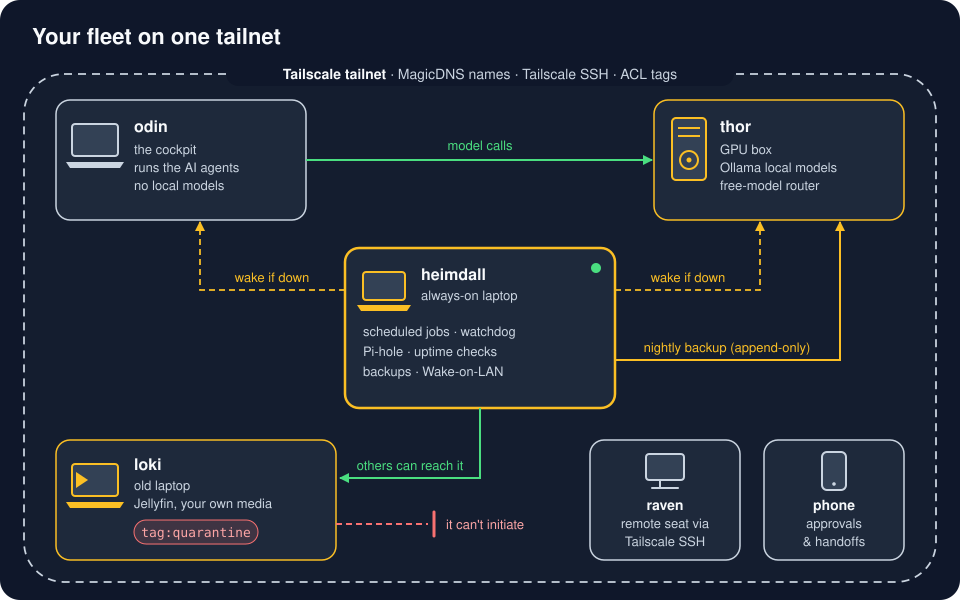

# The fleet

Old hardware becomes useful when every machine has **one job and one name**, and all of them sit on a private Tailscale network (a *tailnet*) where `ssh heimdall` just works from anywhere. The kit uses five names; each is also an installable profile.

| Name | Job | Typical hardware | Rule | Profile |
|---|---|---|---|---|
| **odin** | the cockpit: your daily laptop; runs Claude Code, Codex and the `web` CLI | anything | never runs local models or 24/7 jobs (heat, battery); a guard hook blocks model servers on it | [odin](../profiles/odin/) |
| **thor** | heavy local AI: Ollama, Whisper, the optional free-model router, the backup target | a desktop with an NVIDIA GPU (8 GB VRAM or more), or Apple silicon with 16 GB or more | sleeps when idle; anything that needs it wakes it first | [thor](../profiles/thor/) |
| **heimdall** | always on: scheduled jobs, uptime checks, Wake-on-LAN, alerts, the vault-search embed server, your deployed projects | any old low-power laptop | the default home for scheduled jobs (a job runs elsewhere only when it needs that box, like thor's own sleep check); every job registered with a kill switch | [heimdall](../profiles/heimdall/) |
| **loki** | media server for your own media: Jellyfin, Samba shares | an old laptop with an Intel iGPU and a big disk | one-way: others reach it, it reaches nothing | [loki](../profiles/loki/) |
| **raven** | the viewer: a second laptop or tablet that only connects | anything | stores nothing, runs nothing heavy | [raven](../profiles/raven/) |
| **phone** | approvals, CAPTCHAs, alerts | your phone on the tailnet | the only place a human taps a checkbox | [telegram](../profiles/telegram/) add-on |

You don't need all of them: odin alone is a full setup, one old laptop as heimdall is the biggest next step, and roles can share a box.

## How it hangs together

- **Tailscale** gives every box a stable name (MagicDNS), SSH without passwords (Tailscale SSH), and access rules in one policy file. → [`servers/tailscale.md`](../servers/tailscale.md)
- **One address book.** Tools find the other machines through `~/.config/ai-workflow-kit/hosts.env` (`THOR_HOST`, `THOR_MAC`, `HEIMDALL_HOST`, `EMBED_URL`, ...); a missing value stops a tool with a clear message. Template: [`examples/hosts.env.example`](../examples/hosts.env.example).
- **heimdall watches the others.** `fleet-wake` checks SSH every 2 minutes and sends a Wake-on-LAN packet after three missed checks in a row (about 6 minutes down). A deliberate shutdown or sleep leaves a **hold** marker, so it doesn't wake a box you turned off.
- **Every host watches its own heat.** `host-heat` throttles first, then shuts down cleanly; alerts reach your phone (the only alert that makes a sound).
- **Backups flow one way.** heimdall pushes nightly to thor with an add-only key. thor *pulls* loki's backups through a restricted read-only account, so loki never has to open a connection.

## Sleep when idle, wake on demand

A GPU box that idles all day wastes power and heat. thor suspends itself after an hour with nothing happening:

- **`thor-sleep`** (root timer every 10 min) checks for *real* work, not logins: CPU load, GPU use, a loaded Ollama model that is actually computing, and busy processes (restic, rsync, ffmpeg, apt, docker builds). Six idle checks in a row, then it suspends. A probe that errors counts as busy. Kill switch: `touch /etc/thor-sleep.disable`.
- **Intentional-sleep hold.** Just before any suspend, thor tells heimdall's `fleet-wake` the sleep is on purpose, so heimdall doesn't wake it again minutes later.
- **`thor-up`** wakes it: probe port 22, else Wake-on-LAN plus a request to heimdall's `fleet-wake`, then wait up to 120 s. Anything that needs thor (backups, the local-model fallback of the session distiller, lane calls) runs `thor-up` first. `thor-up --dry-run` prints the plan; `--self-test` runs offline. `THOR_HOST` must be a DNS name or an IPv4/IPv6 address; any other value stops `thor-up` with exit 2 before anything runs.
- **Things that must stay up live elsewhere.** Vault-search embeddings run in a CPU-only container on heimdall for this reason: with thor asleep most of the day, prompt-time search would otherwise fall back to keyword-only.

thor-sleep is Linux-only. On macOS, use the system's own energy settings and keep `thor-up` for the wake.

## Uptime checks that know about sleep

heimdall runs **Uptime Kuma** for HTTP, DNS and push monitors (a backup job calls a push URL on success; silence means an alert). Monitors for a box that sleeps on purpose stay visible but **don't alert**: thor's SSH and Ollama going down after an idle hour is by design, and `fleet-wake` still alerts when a wake fails. Small probes cover what a status page can't: `freellmapi-probe` sends a real completion through the router (and skips while thor holds a sleep), `disk-probe` warns at 90 % full. Each sends one silent message per state change, not one per check. Files: [`framework/_tools/fleet-wake/`](../framework/_tools/fleet-wake/), [`framework/_tools/fleet-probes/`](../framework/_tools/fleet-probes/), [`framework/_tools/host-heat/`](../framework/_tools/host-heat/), [`framework/harness/bin/thor-up`](../framework/harness/bin/thor-up).

## Keeping agent work cool on odin

Agent fan-outs (many subagents, each running tools) can pin every core. On Linux, `claude-slice` starts Claude Code inside a systemd `agents.slice` with a CPU and memory ceiling, so everything it forks inherits the limit; `heavy` does the same with a tighter cap for ffmpeg, whisper or gitleaks. Heavy jobs go to thor, never odin. Files: [`framework/_tools/agents-slice/`](../framework/_tools/agents-slice/).

Build one: [`profiles/`](../profiles/) for what each machine runs, [`servers/README.md`](../servers/README.md) for turning an old laptop into a headless server.
