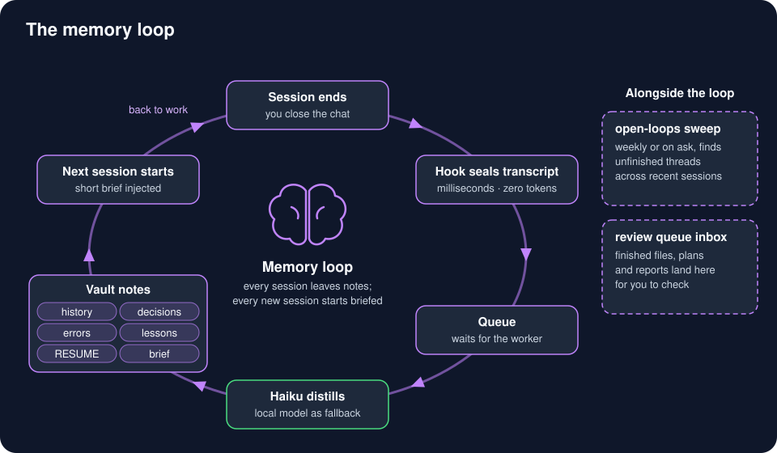

# Memory: a vault that writes itself



Three parts: a plain-markdown **vault**, a pipeline that **writes** to it after every session, and a search that **reads** from it on every prompt. You run none of it by hand.

## The vault

Your second brain is a folder of plain markdown in a private git repo, which any AI can read. It loads lean: a tiny boot file every session, then one file at a time on demand. A starter layout is in [`examples/vault/`](../examples/vault/README.md).

- `Projects/<slug>/`: per-project notes, plus the files the pipeline writes (below)
- `Actions/`: standing defaults ("always do X this way")
- `Reference/`: stable facts (hardware, where things live)
- `harness-memory/`: one fact per file with `name`, `description` and `metadata.type` frontmatter, indexed by a `MEMORY.md` of at most 200 lines

The schema lives in the vault's own `AGENTS.md`, and [`vault-lint`](../framework/_tools/vault-lint/) enforces it with no model at all: frontmatter, size budgets (boot file ≤ 4,000 chars, `MEMORY.md` ≤ 200 lines), dead `[[links]]`, stale `active` notes. `vault_lint.py report` lists problems, `fill --apply` adds missing frontmatter, `rotate --apply` archives old history. The `second-brain` skill handles capture, recall and learn: [`framework/_system/skills/second-brain/`](../framework/_system/skills/second-brain/).

A vault that grows without a check rots quietly. The one this kit came from lost the index to 142 of its 185 memories to a single bad write and nobody noticed for 22 days. Keep it in git, and let a lint and the weekly review look at it.

## Search on every prompt (vault-rag)

A `UserPromptSubmit` hook gives Claude Code and Codex up to three relevant vault chunks before the agent starts, so it stops reading title indexes to find past decisions.

- **Hybrid search:** vector similarity (sqlite-vec, `nomic-embed-text` embeddings) plus keyword search (SQLite FTS5/BM25), merged with reciprocal rank fusion.
- **Only strong hits:** cosine ≥ 0.70, or in keyword-only mode at least 60 % of the query terms. The hook skips short prompts, slash commands and pasted walls of text, never injects the same chunk twice in a session, and keeps its whole output under 1,500 chars. Any error means no output, never a blocked prompt.
- **Embeddings on an always-on CPU box.** The embed model runs in a small CPU-only Ollama container on **heimdall** (3 cores, model kept loaded), not on the GPU box. The GPU box sleeps when idle and queues embeds behind big models. If the embed host doesn't answer in 300 ms (or the embed takes over 3 s), the search answers keyword-only instead of waiting.
- **Ask it yourself:** `vault-recall "how did I fix X"`.
- **Indexing:** a daily timer embeds only changed notes, caches each batch so a killed run resumes, and fingerprints the model so vectors from two different models never mix.

Configure: `EMBED_URL` in `~/.config/ai-workflow-kit/hosts.env`. The index needs it: with it empty, building the index stops with "set EMBED_URL", so there is nothing to search yet. Once an index exists, a query with no embed host (unset, asleep or slow) answers keyword-only. Files: [`framework/_tools/vault-rag/`](../framework/_tools/vault-rag/) (the embed server's Compose file is in `heimdall/`).

## handoff-v2: automatic session distillation

When a session ends, a hook **seals** the transcript and queues it in milliseconds. A detached worker then:

1. pre-filters the transcript in pure Python (prose is under 1 % of a transcript, so 99 % of the reduction costs nothing);
2. routes each item to a project **by evidence**: files edited, hosts ssh'd to, your own words. The folder the session started in doesn't decide;
3. distills it into `history.md`, `decisions.md`, `errors.md`, `lessons.md` (as candidates you approve) and a merged `RESUME.md`;
4. pre-builds a short `_brief.md` that the **next** session start injects.

**Who distills:** Claude **Haiku** by default (model and effort come from the `claude.distill` lane in `lanes.json`), through `claude -p` on your subscription: about 80 s and two calls per session. Any Claude failure (limit, outage, bad output twice) reruns the job on a **local model** on the GPU box; if that is down too, the job waits in the queue. Set `HANDOFF_DISTILLER=ollama` to use only the local model. On a blind-judged comparison of five real sessions, Haiku scored 75.9 against 51.7 for a local 27B model, with half the fabrications. Redaction runs first either way, so no secret reaches a model.

The queue, not the SessionEnd hook, is the durability guarantee: a seal copies its byte range aside, a crashed worker's job goes back to the queue, outages defer a job without counting as a failure, and a job that keeps failing lands in quarantine instead of looping.

**Test isolation guard.** The pipeline refuses to import under a test runner (unittest) unless `HANDOFF_STATE` and `HANDOFF_VAULT` are set; the test setup points them at temporary folders. A misordered test once wrote fixtures into the real vault; now it fails loudly instead.

```bash
python3 -m handoff.cli status         # queue depth, redactor, local model reachable?
python3 -m handoff.cli queue status   # queued / deferred / quarantined, with ages
python3 -m handoff.cli lessons        # candidate lessons waiting for review
```

You run nothing day to day. `/handoff` is an optional deeper pass that shows a draft and writes only what you approve. Files: [`framework/pipeline/handoff-v2/`](../framework/pipeline/handoff-v2/); hook wiring is in [`framework/harness/settings.reference.json`](../framework/harness/settings.reference.json) (SessionStart / SessionEnd / PreCompact / SubagentStart). Copy [`examples/handoff-project-map.json`](../examples/handoff-project-map.json) to `project-map.json` and list your projects there.

## open-loops: what's still open?

A weekly (or on-request) sweep over recent Claude and Codex sessions. It finds loose ends, checks them against reality, plans the fix with the big models, builds with the fast ones, verifies, and closes them into the vault. It runs one phase per call and stops if you're past ~40 % of your usage window. Files: [`framework/_tools/open-loops/`](../framework/_tools/open-loops/), [`framework/.claude/workflows/open-loops.js`](../framework/.claude/workflows/open-loops.js).

## Review queue

Every finished artifact an agent makes (a report, image, PDF or plan) is copied into `~/Review Queue Inbox/`, and a small widget lists it, so you see new work without asking. Logs and intermediate files stay out. Files: [`framework/_tools/review-queue/`](../framework/_tools/review-queue/) (Linux/Hyprland UI; the inbox-folder habit works anywhere).

## Keeping transcripts and disks tidy

- [`retention`](../framework/_tools/retention/) moves old backups and Codex leftovers into a dated archive with a sha256 manifest (never deletes), stops at 1 GiB until you say yes, and restores byte for byte.
- [`secret-scrub`](../framework/_tools/secret-scrub/) finds a leaked password in transcripts and local databases and overwrites it in place.
- [`transcript-prune`](../framework/_tools/transcript-prune/) deletes Codex session logs older than 21 days.
