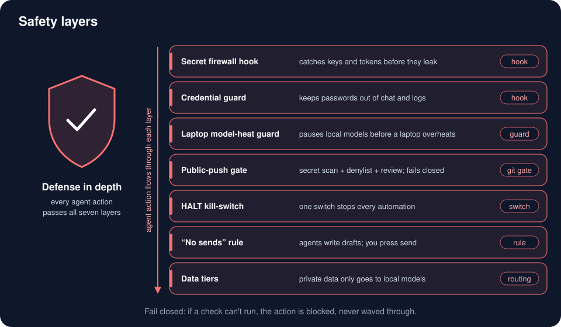

# Safety



The agents run without permission prompts, so the safety comes from layers that are always on, cost little, and **fail closed**: if a safety check can't run, the action is blocked, never waved through.

## Hooks, through one dispatcher

Every `PreToolUse` call goes through one entry point, [`hooks/dispatch/`](../framework/harness/hooks/dispatch/). It runs the five before-hooks below in **one** Python interpreter, each only when its own matcher applies, and merges their answers (deny beats allow; every reason and context is kept). That roughly halves the hook cost of each Bash call (two processes instead of five).

The dispatcher **fails closed for safety hooks**: if the secret firewall, the credential guard or the model guard crashes, times out, is missing, or prints something unreadable, the call is denied with "safety hook <name> failed". An ordinary hook that fails is just dropped. The after-hook (`detect-secrets.py`) runs on its own.

The settings entry that starts the dispatcher is guarded too: `bash "$HOME/.claude/hooks/dispatch/dispatch.sh" PreToolUse || { echo "..." >&2; exit 2; }`. If the dispatcher is missing, unreadable or crashes before answering, the hook exits 2 and Claude Code blocks the call. A home path with spaces or quotes still works: the installer renders every hook path quoted for any home. Only a hang past the hook's 35-second timeout still fails open. The installer also holds back unattended mode (`bypassPermissions` and the skipped prompt) until this dispatcher hook is wired.

| Hook | When | What it stops |
|---|---|---|
| `secret-firewall/block-secrets.py` | before a tool runs | reading, copying or printing secret files and secret values (below) |
| `secret-firewall/detect-secrets.py` | after a tool runs | secrets showing up in output |
| `webcred-guard.sh` | before a tool runs | reaching around the credential courier |
| `odin-model-guard.py` | before a tool runs | starting a local model server on the laptop (heat); one-shot override env var |
| `read-discipline.py`, `bash-inspection.py` | before a tool runs | wasteful whole-file reads and huge outputs (nudges, never safety) |
| `route-guard.py` | before a subagent or Workflow starts | a dispatch that names no model, so nothing falls back to a default (a cost guard, never safety; fails open) |

Hooks never answer "ask"; they allow, deny with a reason, or add context. Files: [`framework/harness/hooks/`](../framework/harness/hooks/), [`framework/pipeline/handoff-v2/hooks/`](../framework/pipeline/handoff-v2/hooks/). The read-before-edit lock hook (`aos-lock-read-fingerprint.sh`, [`agentic-os/aos_lock.py`](../framework/agentic-os/aos_lock.py)) ships but is not wired by default.

## The secret firewall, and what it can't do

The firewall checks the **operands** of a command, not its raw text: a file counts as read only as the argument of a read verb (`cat`, `less`, `jq`, `base64`, `sqlite3` and ~40 more), the source of `cp`/`mv`, a redirect, or a path opened inside `python -c` / `node -e`, `ssh host '...'` or a heredoc. So `grep tokens` and `rg input_tokens` pass, while `cat ~/.codex/auth*`, `au""th.json`, `$'au\x74h.json'`, `f=~/.codex; cat $f/auth.json` and brace or glob tricks are caught. The protected files include the Telegram account logins the [telegram add-on](../profiles/telegram/README.md) uses (`~/.config/telegram/user.session` with its SQLite `-journal`/`-wal`/`-shm` sidecars, and Telegram Desktop's `tdata` store), without touching other apps' files named `session`. It also blocks literal secrets anywhere in a command (provider key prefixes, private-key headers, JWTs, `Authorization:` headers, URL passwords, base64 of any of these), environment dumps, and token-printing CLIs like `gh auth token`. Bad input or any exception denies.

It is scored on a **182-case replay corpus** (96 must-block, 86 must-allow, including evasion pairs: each trick next to a harmless look-alike) by [`secret-firewall-corpus/run.py`](../framework/_tools/secret-firewall-corpus/), which passes only with zero misses and at most two false blocks. The current hook scores 0 misses and 0 false blocks; the hook it replaced caught 13 of 52. On 10,000 real commands it denies 0.23 %.

It is a **guard against accidents, not a security boundary**. It cannot see through arbitrary indirection (`eval "$(printf ...)"`, `base64 -d | sh`, a wrapper script that reads the secret itself), `git show REV:.env`, `curl file://`, a copy in one call and a read in the next, or values printed by `docker inspect` or `ps eww`. Write/Edit *content* is not scanned for secrets. If your agent has passwordless sudo, file ownership is the real wall. The full list is in the corpus README. Run the corpus before every change to the hook:

```bash
python3 framework/_tools/secret-firewall-corpus/run.py --self-test
python3 framework/_tools/secret-firewall-corpus/run.py --hook ~/.claude/hooks/secret-firewall/block-secrets.py
```

## Flagged sessions (web taint)

When a session reads outside text that the scanner flags as possible prompt injection, the web-taint hooks
([`hooks/web-taint/`](../framework/harness/hooks/web-taint/)) put it in guarded mode instead of stopping it. Its local
Bash runs inside a bubblewrap sandbox with no network, the protection files read-only and the user's other sockets
masked; plain pushes to your own GitHub repos pass; every other outward action goes to a tool-less reviewer model that
can only answer allow or deny. A held action is reported, never retried. The sandbox needs `bubblewrap`
(`/usr/bin/bwrap`, in the odin profile, Linux only; `--only claude-harness` leaves it out, so add
`--only claude-harness,bubblewrap`): without it, and on macOS, a flagged session's Bash fails closed until you clear
the flag with `web untaint`.

## Public-push gate

Private repos: no friction. Before **any** push to a public GitHub repo, a global git `pre-push` hook runs, and a `gh` wrapper first on your PATH runs the same gate before a private-to-public flip:

1. a **secret scanner** (`betterleaks`, with `gitleaks` as the fallback) over the whole pushed history, every blob version (added-then-deleted files too, under neutral names so no file is skipped by its name, archives unpacked), and every commit and tag message;
2. a **personal-data denylist** (your name, emails, phone, home paths, hostnames, private project names), kept in a git-ignored `denylist.local.json`, over the same content and the commit metadata;
3. a **Codex review**, read-only, of every commit, for fuzzy personal data the patterns miss.

It **fails closed**: a scanner error, a partial scan, an unreadable blob, or ref updates from git that can't be captured or read (the hook keeps them in a private `mktemp -d` directory) block the push. A deterministic hit can't be argued away by the review. The one-time `GUARD_ALLOW_PUBLIC_PUSH=1` override skips **only** the Codex review; for a denylist false positive add a repo-scoped allowlist entry (it never suppresses secrets); a real secret must leave the history. Files: [`framework/_system/skills/guard/`](../framework/_system/skills/guard/) ([`PUBLIC_PUSH_GATE.md`](../framework/_system/skills/guard/PUBLIC_PUSH_GATE.md)).

This repo runs the same idea on itself: `tools/githooks/pre-commit` scans every staged file for secrets and the maintainer's private terms and refuses non-noreply author emails.

## Automations: opt-in, registered, one kill switch, a kill date

- Skills never schedule themselves. You may stand up any number of automations.
- Each one has a row in `REGISTRY.md` that names its host, schedule and **kill switch** (the exact command that stops it). [`harness-lint`](../framework/_tools/harness-lint/) fails when a timer on any machine of the fleet has no row, or a row has no kill switch.
- Each new automation also gets a **kill date**: a "review by" day about 30 days out, listed in the same file. The review asks one question per row: still used, and still cheaper than not having it? No answer, or "no", means it is switched off (recovery and safety jobs stay). This is what stops a setup from growing a layer per rebuild and removing none (see [lessons](lessons.md)).
- One global `HALT` file (or a budget ceiling of 0) stops every automation at its next preflight check (`preflight.py`). Jobs on your other machines (heat guard, wake-on-LAN, probes) keep their own per-host `HALT` file, because one file on your laptop can't reach them.
- Automations use subscription credits only, never metered API keys.

Files: [`framework/_system/automations/`](../framework/_system/automations/).

## Fleet security monitoring (optional)

heimdall can watch your other machines for signs of compromise. Wazuh agents on each box report logins, changed system files, rootkit checks and vulnerable packages to a manager on heimdall; `wazuh-tg` sends the serious ones (level 12 and up) to your phone, one per rule and box per hour; `fleet-scan` runs a read-only check plus ClamAV over every box's Downloads once a week and sends one message. All of it is **report only**: Wazuh's active response stays off and nothing is blocked, moved or deleted, so a false alarm costs a message, never a stopped job. fleet-scan's key follows the backup rule: pinned with `command=` to one read-only program, over OpenSSH on port 2222, because Tailscale SSH ignores that restriction. An AI agent can read the alerts through the Wazuh MCP server, read-only three ways (key scope, tool list, Wazuh users); alert text is written by whoever controls the watched box, so it is data, never instructions. Setup: [profiles/heimdall](../profiles/heimdall/README.md#monitoring-and-security-optional).

## Remote disk unlock (optional)

Remote disk unlock is opt-in. Once set up, heimdall holds a key that opens the laptop's disk: anyone with root on heimdall, or anything running as your user there, can read it, and a stolen laptop stays locked only while heimdall is not stolen too. If the laptop goes missing, delete its `.luks` file on heimdall; if heimdall is compromised, kill the slot (`luks-unlock-setup --undo --slot N`). Setup: [servers/tools/luks-unlock](../servers/tools/luks-unlock/README.md).

## Behavioural rules

- **No sends.** Builders and automations draft; they never send mail, post, publish, push publicly, delete, restart services or pay.
- **Archive, don't delete.** Cleanup moves files to an archive with a manifest you can restore from.
- **Tests never touch real data.** Code that writes to your vault or state refuses to load under a test runner until the test has set its state and vault paths (to temporary folders).
- **Data tiers.** Private data and client personal data go only to a local model. → [agents and lanes](agents-and-lanes.md)
- **No passwords in chat; never solve CAPTCHAs.** → [web](web.md)
- **Confirm before anything hard to reverse** that you haven't already authorized.
