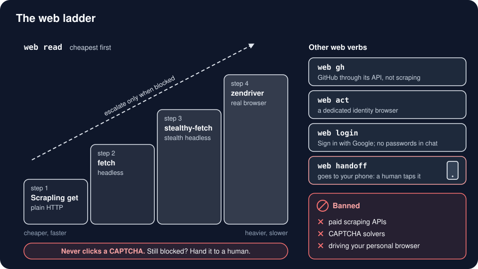

# Web: one CLI for scraping, browsing and logins

Every web job goes through one command, `web`, for both Claude and Codex. Agents never improvise their own scrapers, drive your personal browser, or solve CAPTCHAs.

| Job | Command |
|---|---|
| Read one page | `web read <url>` |
| Crawl a site | `web crawl <url> --max 50` |
| Structured data from a page | `web extract <url> --schema schema.json` |
| Find pages | the agent's **native** web search, then `web read` the hits (`web search` is the keyless fallback) |
| GitHub research | `web gh search "<q>"` / `web gh repo owner/name --readme` (API, never HTML scraping) |
| Click and type in a real browser | `web act <command>` on a dedicated *identity browser* |
| Log in | `web act open <login page>` then `web login <origin>` (Sign in with Google by default) |
| CAPTCHA, 2FA, "are you human" | `web handoff "<reason>"` sends a link to your phone; **you** tap it |
| Saved credentials | `web cred list / gen / intake` (values never shown) |
| Health | `web status` |

## The read ladder

`web read` starts with the cheapest engine and climbs only when it must, remembering per host which rung worked:

1. **Scrapling `get`**: a plain HTTP fetch with a real browser's TLS fingerprint
2. **Scrapling `fetch`**: a headless browser for JavaScript pages
3. **Scrapling stealthy-fetch**: a hardened browser fingerprint (Cloudflare pages usually pass here *without* any clicking)
4. **zendriver**: a full undetected Chrome

A page under 200 characters is accepted only if two engines agree. Long reads have a time budget, and crawls resume where they stopped.

## Hard rules

- **Never solve or click a CAPTCHA.** Banned: CAPTCHA solvers and Scrapling's `--solve-cloudflare` (it clicks the checkbox). A human step goes to `web handoff`.
- **Never a password in chat.** `web login` fills from a local credential courier; you add a credential with `web cred intake` on your phone.
- **Never drive your personal browser.** Logged-in work uses a separate identity browser profile that stays open between sessions.
- **No paid scraping APIs.**
- **Scheduled scrapes run on heimdall,** not your laptop. → [`profiles/heimdall/`](../profiles/heimdall/README.md)

## Desktop apps

For native apps (not web pages) the ladder is:
1. **[computer-use-linux](https://www.npmjs.com/package/@agent-sh/computer-use-linux)** MCP: reads the accessibility tree and clicks elements by name.
2. **desk-control** MCP (in this kit): a visible, stoppable screenshot-and-click loop for pixel-only surfaces like canvases and games, with a sticky Stop hotkey.
3. **chrome-devtools-mcp**: only for debugging *your own* web apps, not for scraping.

Multi-step navigation toward a goal ("find the pricing page") can use `jev-browse`: a cheap model picks each next click and `web act` performs it.

## Files

- CLI source: [`framework/_tools/web/`](../framework/_tools/web/) (Python, install with `uv tool install .`)
- Agent skill: [`framework/_tools/web/skill/SKILL.md`](../framework/_tools/web/skill/SKILL.md) (symlink it into `~/.claude/skills/web` and `~/.codex/skills/web`)
- Credential courier: [`framework/_tools/web/courier/`](../framework/_tools/web/courier/)
- Goal navigator: [`framework/_tools/jev-browse/`](../framework/_tools/jev-browse/)
- Desktop control: [`framework/_tools/desk-control/`](../framework/_tools/desk-control/)

**Linux only as shipped:** it uses `systemd-run` user units, Xvfb and Linux browser paths, and expects a phone notifier (Telegram) for handoffs. On macOS or Windows (WSL), keep the routing rules and the ladder idea, and swap in your platform's service manager and browser paths. The skill file documents every flag.
