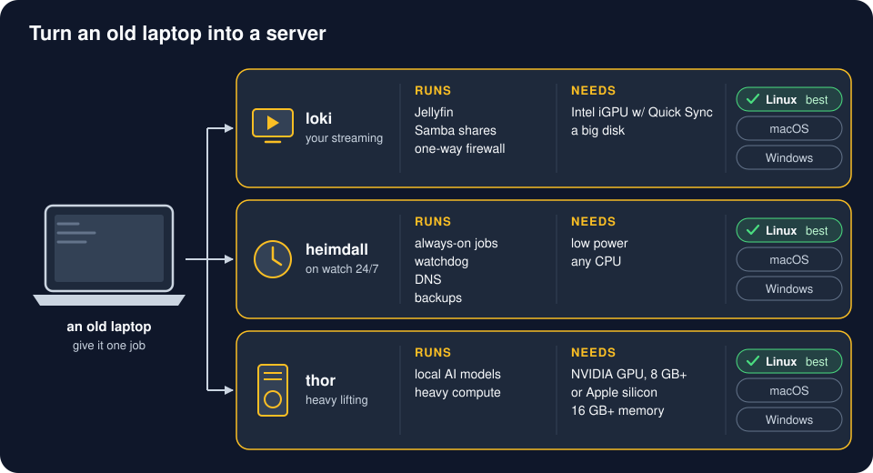

# Old laptops as home servers

Turn a laptop you stopped using into a quiet, always-on server. No screen, no keyboard: it sits on a shelf
with the lid closed, and you reach it from your own laptop or phone over [Tailscale](tailscale.md).



A **lane** is one job per box. One laptop does one thing well, so a crash, an update or a hot day on one
box does not take the others down. You can also run two lanes on one machine; keep loki (the media box) separate.

The three server lanes are the server half of three [profiles](../profiles/README.md), named after the
maintainer's own machines. Each profile page says what the box runs, how to set it up and how to check it.

## Pick your lane

| Lane | What it does | Minimum hardware | Best OS | Page |
|---|---|---|---|---|
| **loki** | Media server: Jellyfin streams your own movies, shows and music to TVs, phones and laptops. Optional download stack locked inside a VPN. One-way firewalled from your other machines; thor pulls its backups. | 4 GB RAM, Intel 7th gen (2017) or newer for smooth hardware transcoding, room for disks | Debian 13 | [profiles/loki](../profiles/loki/README.md) |
| **heimdall** | The watchman. Runs scheduled jobs, checks every box is up (and knows when one sleeps on purpose), sends alerts to your phone, wakes boxes that went down, nightly backups, your deployed projects, optional ad-blocking DNS for the whole house. | Any 64-bit laptop with 4 GB RAM (8 GB is comfortable). Wired Ethernet is best. | Debian 13 | [profiles/heimdall](../profiles/heimdall/README.md) |
| **thor** | Heavy lifting: local AI models (Ollama), Whisper, big jobs, the place backups land. Sleeps when idle; anything that needs it wakes it first. | 16 GB RAM plus an NVIDIA GPU with 8 GB+ VRAM, or an Apple silicon Mac with 16 GB+. Good cooling. | Linux (NVIDIA) or macOS (Apple silicon) | [profiles/thor](../profiles/thor/README.md) |

The other two profiles are not servers: **odin** is your daily computer (where the agents run) and **raven** a
light laptop or tablet that only connects. [profiles/README.md](../profiles/README.md) has all six.

Names used in these docs. They are also the machines' tailnet names, so set the hostname before running a
setup script (Linux: `sudo hostnamectl set-hostname loki`; macOS: `sudo scutil --set LocalHostName loki`;
Windows: `Rename-Computer loki`):

| Name | Role | Older docs called it |
|---|---|---|
| `odin` | your daily laptop. Not a server. | workstation |
| `heimdall` | always-on scheduler and watchdog | heimdall |
| `loki` | media server | mediabox, media |
| `thor` | GPU / compute box, backup target | workhorse |
| `raven` | any device that only connects to the others (old laptop, tablet, phone, Chromebook) | thin-client |

## Picking an old laptop

- **Newer CPU beats more cores.** Intel 7th gen or newer handles 4K/HEVC video in hardware (Quick Sync). Older
  ones work for heimdall.
- **Built-in Ethernet port.** Wi-Fi works, but wired is faster and steadier, and only a built-in port can
  usually be woken remotely (Wake-on-LAN). USB adapters mostly cannot.
- **SSD, 8 GB+ RAM** if you can. Both are cheap to upgrade in older business laptops (Dell Latitude,
  Lenovo ThinkPad, HP EliteBook).
- **Check the battery.** A puffy battery (case bulging, touchpad lifting) must come out before anything else.
  A healthy one doubles as a small UPS.
- **Check the BIOS** for: power on after AC loss, Wake-on-LAN, battery charge limit. Business laptops usually
  have all three; consumer ones often have none. [common.md](common.md#1-bios-once-at-the-keyboard)
- **Thin and light = no heavy jobs.** Running AI models on a thin laptop overheated one to a hard power-off.
  Thin laptops make good heimdall or loki boxes, not thor.
- **Power use:** an idle laptop draws about 5-15 W, a fraction of a desktop.
- Blow the dust out of the fans before it goes on a shelf for years.

## Quick start

1. Install the OS. Linux: Debian 13 netinst, no desktop ("SSH server" + "standard system utilities" only).
   Hands-off install from a USB stick: [linux/preseed.cfg.example](linux/preseed.cfg.example).
2. Get this repo onto the machine (`git clone`, or copy the folder over) and open a terminal in the kit's
   **root folder** (the one with `README.md`, `profiles/` and `servers/`). Every command below runs from there.
3. Preview, then run, one command:

| OS | Command (from the kit's root folder) |
|---|---|
| Linux (Debian/Ubuntu) | `sudo servers/linux/setup.sh heimdall` &nbsp; (preview: `servers/linux/setup.sh heimdall --dry-run`) |
| macOS | `servers/macos/setup.sh thor` &nbsp; (preview: add `--dry-run`) |
| Windows (admin PowerShell) | `powershell -ExecutionPolicy Bypass -File .\servers\windows\setup.ps1 -Lane loki` &nbsp; (preview: add `-DryRun`) |

Use `base`, `loki`, `heimdall` or `thor` as the lane (the old names `media` and `workhorse` still work). The
scripts are safe to re-run, keep a file they replace beside it (`<file>.bak-<time>`), print every action, and end
with a short list of the steps only you can do (approve Tailscale, BIOS settings, paste a key on another box). The
installer runs the same script for you:
`install/install.sh --profile heimdall` (see [install/README.md](../install/README.md)).

On Linux, `--only=power`, `--only=firewall` or `--only=backup` re-runs just that step of a lane, for example
after you changed `/etc/homeserver/backup-pull.conf`. A changed firewall starts on trial: within 5 minutes, open a
NEW SSH session and run `sudo servers/linux/setup.sh --confirm-firewall`, or it rolls back by itself.

## Read next

- [common.md](common.md): what every lane gets (BIOS, lid, SSH, firewall, updates, heat, battery, backups)
- [tailscale.md](tailscale.md): how the boxes find each other, and who may talk to whom
- [profiles/loki](../profiles/loki/README.md) · [profiles/heimdall](../profiles/heimdall/README.md) ·
  [profiles/thor](../profiles/thor/README.md): one page per lane
- [lessons.md](lessons.md): things that went wrong once, so they do not go wrong for you

## What is in here

```
servers/
  linux/setup.sh            Debian/Ubuntu lanes          linux/preseed.cfg.example  hands-off install USB
  linux/test_setup.sh       container tests: power policy, thor's sleep hold, loki backups, one-way firewall
  macos/setup.sh            macOS lanes                  linux/grub-entry.cfg.example
  windows/setup.ps1         Windows lanes
  macos/test_setup.py       container run of every macOS lane: plists parse, no root job runs Homebrew or user-writable
                            code, migration from root jobs, a re-run over Tailscale, or one that cannot tell how you are
                            connected (multiplexers, an ssh from the Mac itself, an open Tailscale ssh or Screen Sharing
                            connection), leaves the old root tailscaled (no cut-off); thor's pf rule is loaded
                            before Ollama's agent is written or started, also through install and load failures,
                            an interrupted run and a restart with the boot job late or failing
  windows/test_setup.ps1    pwsh checks (any OS): the who-may-change-it rule, check-before-lock order, an unsafe
                            alert.cmd is set aside, wake-watch's Python runs with -I -S (with a python3 at hand: a
                            protected .pth naming an outside folder runs nothing), no ._pth, pyvenv.cfg or
                            pybuilddir.txt points it outside its folder and its Lib\os.py is there (-CPython: CPython's
                            own getpath.py agrees), a Python older than 3.13.15 (CVE-2026-12003) is refused,
                            ProgramData and Program Files come from Windows (a hostile %ProgramData% changes
                            nothing), and a junction or user-owned folder above a privileged path is refused
  compose/media|heimdall|workhorse/   Docker Compose files + env.example (loki, heimdall, thor)
  tools/host-heat           heat watch: cools the machine down, shuts down cleanly if cooling fails (Linux)
  tools/wake-watch          wakes a box that went down unexpectedly, once (runs on heimdall)
  tools/alert               one-line phone notification (ntfy / Telegram)
  tools/backup-push         nightly add-only backup from heimdall to thor (wakes thor first) (Linux)
  tools/backup-pull         thor pulls loki's backups through a read-only account (Linux)
  tools/db-snapshot         consistent SQLite copies before a backup (loki, Linux)
  tools/lid-backlight       lid closed = backlight off (Linux)
  tools/media-scan-watch    virus-scan new downloads (Linux)
  tools/freellmapi-bootstrap.sh   optional free-model router on thor (Linux)
  tools/fleet-scan/         weekly read-only compromise check + ClamAV of every box, one message (heimdall, Linux)
  tools/wazuh-tg/           Wazuh level 12+ alerts to your phone (heimdall, Linux)
  tools/luks-unlock/        heimdall unlocks an encrypted laptop's disk at boot (one-time setup + docs)
  tools/media-backup/       nightly restic copy of thor's media to a second drive (+ Immich database dump)
  tools/ac-power-profile/   laptop power profile follows the charger (raven)
  tools/ssh-keylog/         log what each ssh key runs, then report per key
  compose/workhorse/immich/ optional Immich photo library on thor
  tools/systemd/            the unit and timer files the Linux script installs
media.md heimdall.md workhorse.md   moved: one-line pointers to profiles/loki, heimdall, thor
```
